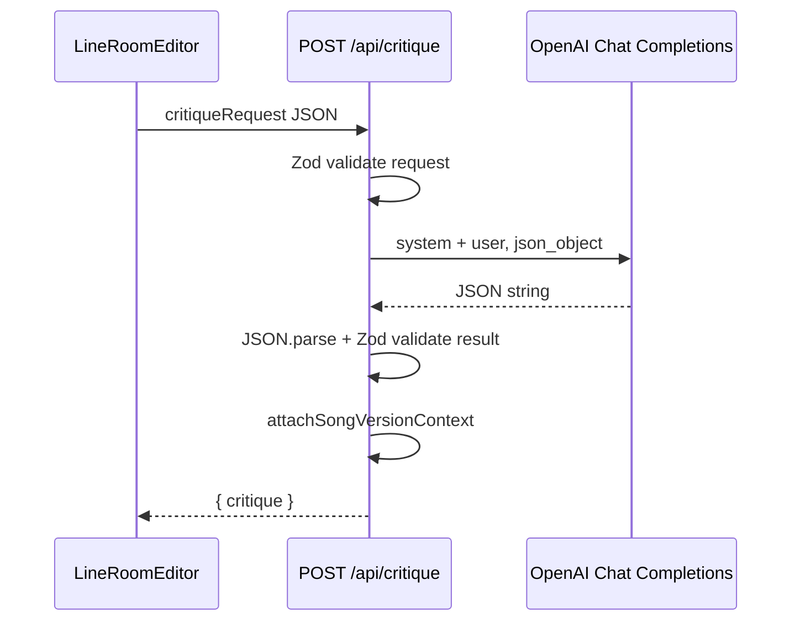

# Generate Critique: LLM architecture

This document describes how the **Generate Critique** feature uses the language model in LineRoom: request path, prompts, structured output, validation, and the main design choices.

## Purpose

Critique produces a **single structured evaluation** of the current draft (lyrics or poetry): genre-aware principles, an overall quality band, seven numeric subscores, holistic strengths/weaknesses, and line-level feedback with optional strength labels. That object is stored, shown in the critique panel, and reused by the **lyric chat** as authoritative context.

## End-to-end flow

1. **Client** (`components/LineRoomEditor.tsx`): The user triggers critique (first generation or **Regenerate**). The client `POST`s JSON to `/api/critique` with the draft, title, genre/similar-artists meta, and optional song-version context.
2. **API route** (`app/api/critique/route.ts`): Validates the body with Zod, builds the **user** message from `buildCritiqueUserPayload`, calls OpenAI **Chat Completions** with a fixed **system** prompt (`CRITIQUE_JSON_INSTRUCTIONS`) and `response_format: { type: "json_object" }`.
3. **Response handling**: The assistant message is parsed as JSON and validated again with `critiqueResultSchema`. Server code then **attaches** song-version metadata (`attachSongVersionContext`) that the model does not emit.
4. **Client**: On success, the critique is stored in React state; in **song** mode the editor may persist and version the result (save + new version + navigation)—that persistence is product flow, not part of the LLM call itself.

## Key files

| Area | Location |
|------|----------|
| HTTP handler, OpenAI call, tracing wrapper | `app/api/critique/route.ts` |
| System prompt + user payload builder | `lib/prompts.ts` (`CRITIQUE_JSON_INSTRUCTIONS`, `buildCritiqueUserPayload`) |
| Request/response Zod schemas | `lib/validators.ts` (`critiqueRequestSchema`, `critiqueResultSchema`, related line/band types) |
| TypeScript types | `lib/types.ts` (`CritiqueResult`, `PriorVersionContext`, …) |
| OpenAI client + model name | `lib/openai.ts` (`createBaseOpenAI`, `getChatModel`) |
| Langfuse trace/generation | `lib/langfuse-server.ts` (`runWithLangfuseTrace`, `scheduleLangfuseFlush`) |
| UI trigger + payload assembly | `components/LineRoomEditor.tsx` (`runCritique`) |
| Prior version rows for song mode | `app/song/[songId]/page.tsx` → `priorVersionsContext` |

## Request contract (`critiqueRequestSchema`)

The API expects:

- **Draft & context**: `fullText` (required), `title`, `genre`, `similarArtists`.
- **Regeneration**: `regenerate` plus `priorCritique` when replacing an existing critique so the model can write a **comparative** `overallBandRationale`.
- **Iteration stability**: Up to **8** `priorVersions` entries (`versionNumber`, `draftText`, `critique | null`). In song mode the server supplies up to **5** most recent older versions (newest-first in the array used by the client), each with saved draft + saved critique snapshot.
- **Song bookkeeping** (optional): `analyzedSongVersion`, `priorSongVersionCompared`—used **after** the model returns to set `comparedToSummary` and version fields on the result object.

## LLM call shape

- **Model**: `getChatModel()` → `process.env.OPENAI_MODEL` or default **`gpt-5-mini`** (see `lib/openai.ts`).
- **Messages**:
  - **System**: Long, static `CRITIQUE_JSON_INSTRUCTIONS`—role, craft principles, output JSON shape, calibration rules, and constraints (e.g. line feedback count, praise ratio, subscore stability when prior context exists).
  - **User**: Dynamic string from `buildCritiqueUserPayload`—title, genre, version context, optional **draft change summary** vs. latest prior, optional **prior versions** blocks (truncated drafts + critique summaries), optional **regeneration** block with the full previous critique snapshot, then the full current draft in a fenced block.
- **Structured output**: `response_format: { type: "json_object" }` nudges a single JSON object matching the documented keys (no markdown fences in the ideal case).

## Prompt design (why it is split this way)

- **System vs user**: The **system** message holds stable instructions, scoring philosophy, and the exact JSON schema. The **user** message holds instance-specific text: metadata, historical versions, regeneration instructions, and the draft. That keeps the contract visible in one place and avoids duplicating long rules in every request.
- **Genre- and intent-aware critique**: Instructions explicitly reject a single universal aesthetic; subscores and bands are **not** a naive average of dimensions; prosody and hooks are interpreted **by genre**.
- **Continuity across edits**: `priorVersions` plus explicit rules (“treat prior subscores as baseline”, “avoid polarity flips”) aim to reduce whiplash when the user iterates.
- **Regeneration mode**: When `regenerate` and `priorCritique` are present, the user payload switches to **Regeneration mode**: `overallBandRationale` becomes **required** and must include a fixed comparison to the previous critique (better / worse / unchanged + reason).
- **Cheap draft delta signal**: `buildCritiqueUserPayload` computes a simple line-set diff (added / removed / retained counts and a rough “percent changed”) between the current draft and the **first** prior version entry to give the model a lightweight revision summary without another LLM call.

## Output contract (`critiqueResultSchema`)

Validated fields include:

- `genrePrinciples`, `overallRatingBand` (enum), optional `overallBandRationale`
- `subscores`: seven dimensions, each **1–5** integer
- `overallStrengths` / `overallWeaknesses`: string arrays
- `lineFeedback`: items with `quotedLine`, `feedback`, `category` (`praise` | `constructive`), optional `strength` (`strong` | `promising` | `weak`)

Version-related fields **`analyzedSongVersion`**, **`priorSongVersionCompared`**, and **`comparedToSummary`** are part of the **TypeScript** `CritiqueResult` type and may be **set or cleared on the server** via `attachSongVersionContext` so the UI can show what was compared without trusting the model to echo IDs correctly.

## Validation strategy

1. **Request**: Invalid payloads return `400` with Zod flatten details.
2. **Model output**: Empty content, non-JSON, or JSON that fails `critiqueResultSchema` → `502` with a generic error message (shape failures are not exposed in detail to the client).
3. **Defense in depth**: JSON mode reduces but does not eliminate malformed output; **server-side Zod** is the source of truth for what the app will accept.

## Observability

When Langfuse env vars are set, the route runs inside `runWithLangfuseTrace` with trace name **LineRoom**, observation **lineroom-critique**, generation name **lyric-critique**, and tags `lineroom`, `critique`. Trace input/output are set to the **validated** request payload and final critique object. `scheduleLangfuseFlush` uses Next.js `after()` so spans flush on serverless deployments.

## Design choices (summary)

| Choice | Rationale |
|--------|-----------|
| **Chat Completions + `json_object`** | One shot, structured result; simpler than tool-calling for a fixed schema. |
| **Zod on request and response** | Strict contracts at the boundary; safe failure modes; shared schemas with client parsing (e.g. localStorage critique restore). |
| **Server fills version metadata** | Correct, consistent `comparedToSummary` and version numbers regardless of model compliance. |
| **Large static system prompt** | Encodes product voice, calibration, and JSON shape without bloating every user message. |
| **Prior versions in user message** | Grounds iteration in real saved drafts/critiques; truncation (~1800 chars per prior draft) caps tokens. |
| **Regeneration as explicit mode** | Forces comparative rationale when the user replaces a critique, improving transparency of “what changed.” |

## Related: chat, not critique generation

The separate **`/api/chat`** route uses `buildLyricChatSystemPrompt` and injects a **text summary** of the saved critique for follow-up Q&A. That path does **not** regenerate the structured critique; it treats the stored `CritiqueResult` as authoritative. See `app/api/chat/route.ts` and `formatCritiqueForChat` there.
